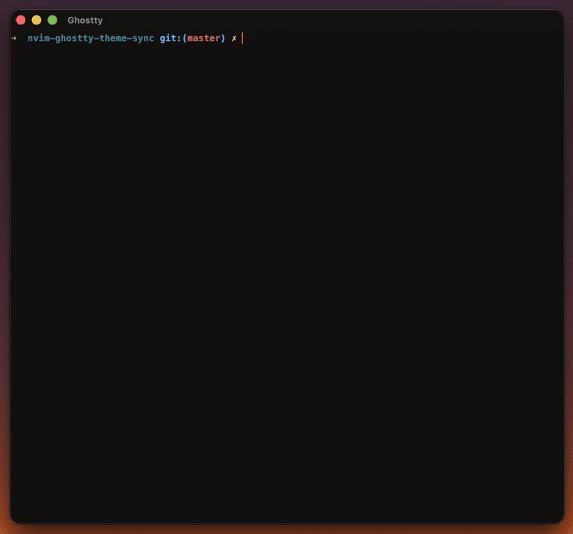

# nvim-ghostty-theme-sync

Sync your Neovim colorscheme to Ghostty. Generates custom Ghostty theme files from your current nvim colors and updates the Ghostty config to use them. Supports dark/light mode switching.

## Demo



## Usage

Run `:GhosttySyncTheme` in Neovim, then Reload Config in Ghostty (`Cmd+Shift+,` on macOS, `Ctrl+Shift+,` on Linux).

## How it works

1. Reads your current nvim highlight groups (Normal, Cursor, Visual, terminal colors, etc.)
2. Detects if your colorscheme has both dark and light variants
3. Generates Ghostty theme files in your user themes directory (`$XDG_CONFIG_HOME/ghostty/themes`, default `~/.config/ghostty/themes/`)
4. Updates your Ghostty config with mode-aware theme: `theme = dark:NAME-dark, light:NAME-light` (the config file is created if it doesn't exist yet)
5. If no light variant exists, uses the same theme for both modes

## Installation

With lazy.nvim:

```lua
{
  "JumpToSkyFree/nvim-ghostty-theme-sync",
  -- opts is optional; the plugin works with defaults:
  -- opts = {
  --   -- Optional: custom Ghostty config path (auto-detected on all platforms)
  --   -- ghostty_config_path = "~/.config/ghostty/config",
  --   -- Optional: custom theme name (default: "nvim-synced")
  --   -- theme_name = "nvim-synced",
  -- },
}
```

## Configuration

| Option | Type | Default | Description |
|--------|------|---------|-------------|
| `ghostty_config_path` | string | auto-detected | Path to Ghostty config file |
| `theme_name` | string | `"nvim-synced"` | Name of the generated theme files |

## Platform Support

| Platform | Config Path (first match wins) | Themes Path |
|----------|--------------------------------|-------------|
| macOS | `~/Library/Application Support/com.mitchellh.ghostty/config.ghostty` or `config`, then the XDG path | `$XDG_CONFIG_HOME/ghostty/themes/` (default `~/.config/ghostty/themes/`) |
| Linux | `$XDG_CONFIG_HOME/ghostty/config.ghostty` or `config` (defaults to `~/.config/ghostty/`) | same as macOS |
| Windows | `%LOCALAPPDATA%\ghostty\config.ghostty` or `config` | `%LOCALAPPDATA%\ghostty\themes\` |

## Requirements

- Neovim 0.9+
- Ghostty installed
- macOS, Linux, or Windows

## How the colors map

| Nvim Highlight | Ghostty Color |
|---------------|---------------|
| `Normal` bg | `background` |
| `Normal` fg | `foreground` |
| `Cursor` | `cursor-color` / `cursor-text` |
| `Visual` | `selection-background` / `selection-foreground` |
| `g:terminal_color_0` through `_15` | `palette = 0` through `15` |

If terminal colors are not set by your colorscheme, they are derived from diagnostic/statement highlights.
